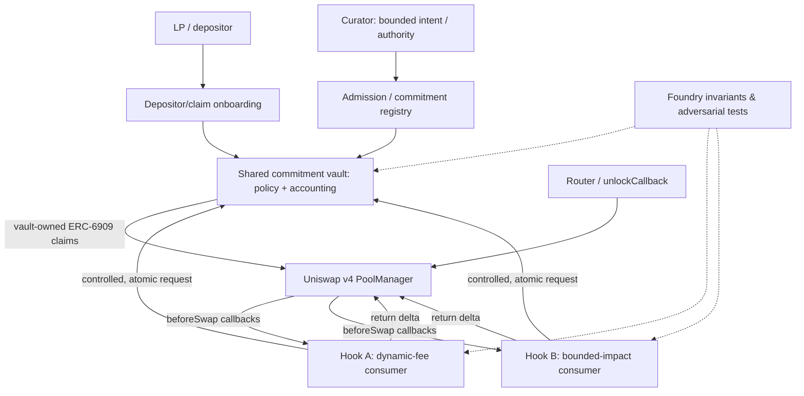

# Architecture hypothesis (v0 / feasibility)

*Diagram is conceptual and is not an assertion that ERC-6909 claims can be spent by arbitrary hooks safely. The actual flow is the primary feasibility question.*

## Trust boundaries to demonstrate

- PoolManager controls currency deltas, flash accounting, ERC-6909 mints/burns, and requires all deltas zero before unlock completes.
- The vault, not the hook, controls LP reserve claims. A hook must not hold an unlimited ERC-6909 operator approval over the vault.
- Admission binds **consumer address + pool id + currency + per-epoch quota + maximum amount + expiry** to a single operation. A stale or replayed request must fail.
- Hook code is not assumed benign merely because it implements `ICommitmentConsumer`. Whitelisting and audited adapter logic are explicit trust assumptions.
- Real-time withdrawable backing is not equivalent to deployed, lent, promised, or hypothetical reserve value.
- Quote availability is not a guarantee of inclusion, price, gas, liveness, or execution. Identify which quantity is actually guaranteed.

## Read-this-first constraints

1. `beforeSwapReturnDelta` is a hook callback with a particular delta/sign and exact-in/exact-out encoding, **not** generic cross-pool fund transfer.
2. ERC-6909 claim balances exist on the real PoolManager and must reconcile with transient deltas; mint/burn are not free money.
3. Independent hooks with different pricing logic can consume shared backing only with explicit accounting of **both** assets and exchange risk.
4. Fixed-size ring buffer must address long gaps, slot reuse, wraparound, bucket aggregation and whether expiry is lazily recognized during subsequent interactions.
5. A dynamic LP fee override applies only to pools actually configured for dynamic fees.
6. No liquidity reserve design can assert unconditional immediate full withdrawal while the same capital remains irrevocably committed elsewhere. Specify cancellation, queue, haircut or a provable instant-redemption bound.
