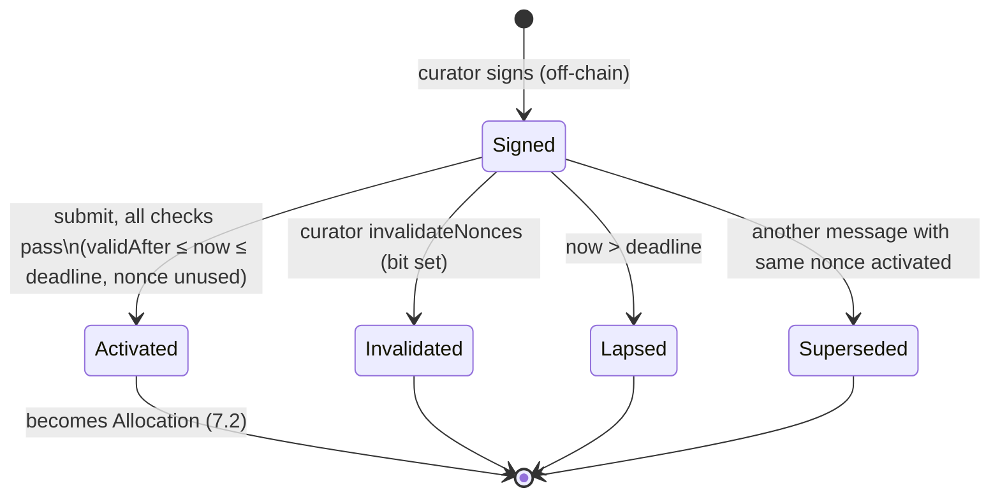

# Porkfolio — Phase 1B-0: Curator Authorization and Permissions (Specification)

**Status: SPECIFICATION FOR REVIEW. Nothing in this document is implemented.** Labels (SOURCE, OBSERVED, ASSUMPTION,
PROPOSAL, DECISION) are defined in `PHASE1B_PRICE_POLICY.md`. The price rules referenced here (`f_v`, `f_c`, `F_eff`,
halt, guardian) are specified there. Threats, invariants and tests are in `PHASE1B_THREATS_AND_PLAN.md`.

---

## 1. Three things that must not be confused

| Concept | Where it lives | Reserves capacity? | Can move assets? |
|---|---|---|---|
| **Signed authorization**: an EIP-712 message from a curator | Off-chain only, until submitted | **No** | No |
| **Allocation**: an activated authorization (committed or reserved capacity) | Vault storage `_allocations[id]` | **Yes**: `maxOut − consumed` counts in `Q_a` | Only through `exchange`, by its bound hook |
| **Consumption**: one `exchange` call against an allocation | Vault storage (`consumed`) and PoolManager claims | Lowers `Q_a` by `amountOut` | Yes, within quota and `F_eff` |

- A signature is **authority**, not capacity. Many signed authorizations may exist off-chain, and their total `maxOut`
  may exceed everything the vault holds.
- Capacity is reserved only at **activation**, which re-checks admission (`Q_a + q + R_a + D_a ≤ N_a`) and the
  curator ceiling at that moment.
- **Activation and registration are one step (PROPOSAL).** There is no "registered but not reserved" state. A separate
  registration step would add state and a second race window without protecting anything.
- **Lazy activation is rejected.** Under that alternative, the first swap would carry the signature in `hookData`. It
  was rejected for three reasons:
  - signature verification (including an ERC-1271 call) would run inside `beforeSwap`;
  - capacity would not be reserved until the swap;
  - the hook would become part of the authorization path.

## 2. Starting point (Phase 1A-H, SOURCE)

- `allocate(AllocationRequest)` treats `msg.sender` as the curator. The request carries `consumer`, `key`,
  `currencyOut`, `maxOut`, `minInPerOutX96`, `expiry`, `nonce` and `deadline`.
- Replay protection is `nonceUsed[curator][nonce]`, one storage slot per nonce.
- `release(id)` may be called by anyone after `expiry`, and by the owner at any time.
- Curators cannot cancel their own allocations.
- Ceilings `curatorCeiling[curator][currency]` bound the outstanding reserved amount, not cumulative volume.

Phase 1B keeps the allocation storage, the ceilings, the admission rule and the `exchange` settlement unchanged. It
replaces the request struct, the nonce store and the release entry points.

## 3. EIP-712 domain

```
EIP712Domain(string name, string version, uint256 chainId, address verifyingContract)
name              = "Porkfolio Vault"        (DECISION D11)
version           = "1"
chainId           = block.chainid            (recomputed if the chain id changes, e.g. after a fork)
verifyingContract = address(vault)
```

**Implementation basis.**

- **Chosen: OpenZeppelin `EIP712` v5.0.2** (vendored at `lib/v4-periphery/lib/v4-core/lib/openzeppelin-contracts`;
  SOURCE: `package.json` 5.0.2). It includes `version`, caches the separator, rebuilds it when `block.chainid` or
  `address(this)` differs, and exposes ERC-5267 `eip712Domain()`.
- **Not chosen: v4-periphery `EIP712_v4`.** Its domain is
  `EIP712Domain(string name,uint256 chainId,address verifyingContract)`, with **no version** (SOURCE). It therefore does
  not meet the domain requirement.
- **Setup required.** A remapping `@openzeppelin/contracts/=lib/v4-periphery/lib/v4-core/lib/openzeppelin-contracts/contracts/`
  must be added. No new dependency is downloaded.

The vault is not upgradeable and is never `delegatecall`ed. So `verifyingContract` is always the contract that verifies
(OZ's `_cachedThis` check covers the contrary case regardless).

## 4. Message schema

```
CuratorAuthorization(
    address curator,
    address vault,
    address consumer,
    bytes32 poolId,
    bool    zeroForOne,
    address currencyIn,
    address currencyOut,
    uint128 maxOut,
    uint160 minInPerOutX96,
    uint64  validAfter,
    uint64  deadline,
    uint64  expiry,
    uint256 nonce
)
```

`structHash = keccak256(abi.encode(CURATOR_AUTHORIZATION_TYPEHASH, …fields in order…))`. All fields are static types,
so no nested hashing is needed. The digest is `_hashTypedDataV4(structHash)`, and the **authorization id** is that
digest (emitted in events and used by off-chain tooling).

| Field | Meaning | Checked at activation |
|---|---|---|
| `curator` | The authority. Signer (EOA) or ERC-1271 wallet address. | `isCurator[curator]` on both paths (`CURATOR_REVOCATION.md` R1; added after review); signature valid for `curator` (§5); `curatorCeiling[curator][currencyOut]` has room |
| `vault` | The vault this authorization is for | `== address(this)`. Redundant with `verifyingContract`; kept so that wallets display it and as defence in depth. |
| `consumer` | The only hook that may consume | `isConsumer[consumer]`; `key.hooks == consumer` |
| `poolId` | The pool, which commits to `(currency0, currency1, fee, tickSpacing, hooks)` (SOURCE: `PoolIdLibrary.toId` is the keccak of the key) | `key.toId() == poolId`, where `key` is supplied in calldata by the submitter |
| `zeroForOne` | Swap direction authorised | `currencyOut == (zeroForOne ? key.currency1 : key.currency0)` |
| `currencyIn`, `currencyOut` | Explicit asset identities | consistent with the key and with `zeroForOne`; `key.currency0/1 == asset0/1` |
| `maxOut` | Maximum gross outflow (quota), raw `currencyOut` units | `0 < maxOut ≤ MAX_AMOUNT`; admission; ceiling |
| `minInPerOutX96` | Curator floor `f_c` | `≠ 0`; `≥ f_v[currencyOut]`; direction configured and not halted (`PHASE1B_PRICE_POLICY.md` §4.1) |
| `validAfter` | Earliest activation time | `block.timestamp ≥ validAfter` |
| `deadline` | Latest activation time | `block.timestamp ≤ deadline` |
| `expiry` | End of the consumption window (absolute) | `block.timestamp < expiry ≤ block.timestamp + MAX_HORIZON` |
| `nonce` | Curator-scoped unique identifier | unused in the curator's bitmap (§6) |

Notes:

- **The expiry is absolute.** A relative duration would let a submitter push the consumption window later by
  activating late. Curators should sign `validAfter ≥ expiry − MAX_HORIZON`, or early activation reverts with
  `HorizonExceeded`.
- **`deadline` and `expiry` are different.** `deadline` bounds activation of the authorization; `expiry` bounds use of
  the allocation. Phase 1A-H already uses these names with these meanings.
- **The PoolKey is not signed directly.** It is a nested struct, and `poolId` already commits to it. The submitter
  supplies the key, and the vault recomputes its id.
- **One struct for both paths (PROPOSAL, DECISION D6).** The direct path `allocate(auth, key)` takes the same struct,
  requires `auth.curator == msg.sender` and skips signature verification. Both paths share one internal `_activate`,
  so their checks, nonce space and accounting are identical.

## 5. Signature verification

**Implementation:** OZ 5.0.2 `SignatureChecker.isValidSignatureNow(curator, digest, signature)`.

| Step | Behaviour (SOURCE: vendored OZ 5.0.2) |
|---|---|
| ECDSA attempt | `ECDSA.tryRecover`. Accepts only 65-byte signatures; rejects high-`s` (malleable) signatures; any other `v` makes `ecrecover` return `address(0)`, which is rejected; never reverts. Succeeds if `recovered == curator`. |
| ERC-1271 fallback | `curator.staticcall(isValidSignature(digest, signature))`. Valid iff the call succeeds, returns ≥ 32 bytes, and the first word equals `0x1626ba7e`. For an EOA curator with a bad ECDSA signature, the call to a code-less address returns no data, so it is rejected. |
| Result | `false` → revert `InvalidSignature()`. There is no partial acceptance. |

### 5.1 EOA curators

Standard 65-byte `(r, s, v)` signatures. Compact 64-byte EIP-2098 signatures are rejected: OZ 5.0.2 `tryRecover(bytes)`
accepts only 65 bytes.

### 5.2 Smart-contract curators (ERC-1271)

- **Verified once, at activation.** OZ notes that a contract signature can become invalid later. Phase 1B treats that
  as expected: once activated, an allocation is a stored commitment, and **is not re-verified** at `exchange`. A wallet
  that wants to stop an activated allocation calls `cancelAllocation` (§7).
- **Counterfactual wallets (ERC-6492) are not supported.** The wallet must already be deployed.
- **One signer, several wallets.** Several wallets may accept signatures from the same EOA owner. Because `curator` is
  inside the signed struct, a signature produced for wallet A's digest cannot be presented as wallet B: B's struct has
  `curator = B`, so the digest differs. The vault does not depend on the wallet implementing ERC-7739.
- **EIP-7702-delegated EOAs.** An EOA with delegated code still verifies through the ECDSA branch, because OZ tries
  ECDSA first, so its plain key signatures keep working. **ASSUMPTION:** whether the target chain supports EIP-7702 was
  not verified. The behaviour above is correct either way.
- **Gas griefing.** A curator contract can burn up to the forwarded gas, or return a large payload that the caller then
  copies. This only harms the transaction's submitter, who chose to submit that curator's authorization. Relayers
  should simulate before submitting.

### 5.3 Reentrancy and ordering

- **`staticcall` cannot write state.** Any `SSTORE`, `LOG` or value transfer in the wallet's `isValidSignature`
  reverts, and so does any nested call that attempts one. A reentrant attempt therefore makes the call fail, and
  activation reverts with `InvalidSignature`.
- **Verification runs after every cheap check and before any effect** (nonce, `Q_a`, `curatorReserved`, allocation
  storage). A read-only reentrant view during verification sees the consistent pre-activation state.

## 6. Nonces

**PROPOSAL: unordered nonce bitmap**, the same layout as v4-periphery `UnorderedNonce` and Permit2 (SOURCE):

```
mapping(address curator => mapping(uint256 wordPos => uint256 bitmap)) public nonceBitmap;
nonce = (wordPos << 8) | bitPos
```

- **Single use.** Activation flips the bit. If it was already set, activation reverts with
  `NonceAlreadyUsed(curator, nonce)`.
- **Any order.** Nonces may be used in any order. Out-of-order activation of independent authorizations is normal for a
  relayer and is not an error.
- **Bulk invalidation.** `invalidateNonces(wordPos, mask)` sets every bit of `mask` in the caller's word, so up to 256
  unactivated authorizations can be invalidated per call. Setting an already-set bit is idempotent and does not revert,
  so bulk cancellation cannot be front-run into failure. Emits `NoncesInvalidated(curator, wordPos, mask)`.
- **Shared nonce space.** The direct and signed paths share it.
- **Replay key.** The key is `(curator, nonce)`, **not** the digest. Two different messages signed with the same nonce
  can activate at most once in total. Keying by digest would allow both.
- **Cost (to be measured).** Bitmaps amortise storage: one slot covers 256 nonces. The current one-slot-per-nonce mapping
  writes a fresh slot on every activation. No gas figure is claimed until measured.
- **Lapsed authorizations** (deadline passed, nonce unused) leave their nonce **unused**. The curator may reuse it in a
  new message, because the old message can no longer activate (`deadline` has passed). Tooling should still prefer
  fresh nonces.

## 7. Lifecycle and state machine

### 7.1 Authorization (per signed message)



`Signed`, `Lapsed` and `Superseded` have **no on-chain state**; they are derived. The on-chain state per
`(curator, nonce)` is exactly one bit: unused or used. `Activated` and `Invalidated` both set it, and neither can be
undone.

### 7.2 Allocation (on-chain)

| State | Definition (derived from storage and time) | `Q_a` contribution |
|---|---|---|
| **Active** | `!released`, `now < expiry`, `consumed < maxOut` | `maxOut − consumed` |
| **Exhausted** | `!released`, `consumed == maxOut` | 0 |
| **Expired** | `!released`, `now ≥ expiry` | `maxOut − consumed` (lazy: still reserved until `release`) |
| **Closed** | `released == true`, with reason `Expired`, `Canceled` or `Emergency` in the event | 0 |

Being consumable is **Active** *and* all of: not `paused`, consumer still registered, direction not halted,
`f_v[out] ≠ 0`, and the trade meets `F_eff`. These conditions are not states. They can flip back, and they do not
change accounting.

### 7.3 Transitions

| # | Transition | Who | Guard | Effects | Event |
|---|---|---|---|---|---|
| A1 | Signed → Active (signed path) | **anyone** (relayer) | not paused; all §4 checks; valid signature; nonce unused | set nonce bit; `Q_out += maxOut`; `curatorReserved[curator][out] += maxOut`; store allocation with `curator`, `consumer`, `poolId`, `currencyIn`, `currencyOut`, `maxOut`, `consumed = 0`, `f_c`, `expiry` | `AllocationActivated(id, curator, consumer, authId, nonce, …)` |
| A2 | Signed → Active (direct path) | `curator` itself | same as A1, with `msg.sender == auth.curator` instead of a signature | same | same (`authId` = digest of the same struct) |
| N1 | Signed → Invalidated | `curator` | none | set bits | `NoncesInvalidated` |
| C1 | Active → Active (partial consumption) | bound `consumer` | `PHASE1B_PRICE_POLICY.md` §4.1; `amountOut < remaining` | `consumed += out`; `Q_out −= out`; `curatorReserved −= out`; `B_out −= out`; `B_in += in`; pull in, then push out (unchanged) | `AllocationConsumed` |
| C2 | Active → Exhausted (full consumption) | bound `consumer` | as C1, with `amountOut == remaining` | same as C1 | `AllocationConsumed` |
| X1 | Active / Exhausted → Closed (curator cancel) | **`a.curator` only** | not already closed. Allowed before expiry and while paused. | `released = true`; `Q_out −= remaining`; `curatorReserved −= remaining` | `AllocationReleased(id, by, unused, Canceled)` |
| X2 | any non-closed state → Closed (emergency) | owner **or guardian** | not already closed | same as X1 | `…, Emergency` |
| X3 | Expired → Closed (lazy expiry) | **anyone** | `now ≥ expiry`; not already closed | same as X1 | `…, Expired` |
| — | Closed → anything | — | **impossible**. Every function that uses an allocation reverts on `released` (SOURCE: `_getLiveAllocation`). | — | — |

Deadline expiration (`now > deadline`) affects only *Signed* messages. Allocation expiry (`now ≥ expiry`) affects only
*allocations*. An Expired allocation cannot be consumed (`AllocationExpired`) but keeps its reservation until X3, X1 or
X2. That is the lazy expiry already documented and tested (OBSERVED: `test_lazyRelease`).

### 7.4 Cancellation after partial consumption

`consumed` is never reduced, and the consumed output has already been exchanged for input that now belongs to all
shares. Cancellation releases only `remaining = maxOut − consumed`. The nonce stays used, so the same authorization can
never be re-activated. To continue, the curator signs a new authorization with a new nonce, which must pass admission
and its ceiling again.

### 7.5 Revocation races (all resolved by transaction order; each outcome is safe)

| Race | Outcome if the revocation lands first | Outcome if the other transaction lands first |
|---|---|---|
| Curator `invalidateNonces` vs relayer activation | activation reverts `NonceAlreadyUsed` | allocation exists. Invalidation still succeeds (idempotent), and the curator then calls `cancelAllocation` (X1). Tooling must check `AllocationActivated` for that nonce. |
| Curator cancel vs swap | swap reverts `AllocationAlreadyReleased` | swap consumes; cancel releases the smaller remainder |
| Guardian or owner emergency release vs swap | same as above | same as above |
| Guardian tightens `f_v` or halts vs swap | swap reverts `PriceBelowFloor` or `DirectionHalted` | swap executes at the old `f_v` (it was valid at execution) |
| Owner deregisters hook vs activation or swap | activation and swap revert `ConsumerNotRegistered` | as executed. The allocation then cannot be consumed; release it (X1, X2 or X3). |
| Guardian lowers ceiling vs activation | activation reverts `CuratorCeilingExceeded` | allocation exists. A ceiling bounds **new** reservations only, so emergency release is needed to remove it. |
| Guardian or owner deregisters the curator vs relayer activation of its signature | activation reverts `CuratorNotRegistered` (R1) | allocation exists and stays consumable until X1, X2 or X3 (`CURATOR_REVOCATION.md` §2) |
| Owner re-registers a previously deregistered curator | — | every outstanding signature of that curator becomes activatable again unless D15 is adopted (`CURATOR_REVOCATION.md` §4) |

In every row, each unit of capacity is released **at most once** and consumed **at most once**, and
`consumed + released_unused ≤ maxOut`. These are invariants INV-A2 and INV-A3 in `PHASE1B_THREATS_AND_PLAN.md`.

## 8. Integration with existing allocation accounting

Unchanged relations (SOURCE, `SHARE_ACCOUNTING.md`):

```
Q_a = Σ_{unreleased j, out=a} (maxOut_j − consumed_j)
curatorReserved[c][a] = Σ_{unreleased j, curator=c, out=a} (maxOut_j − consumed_j)
admission:  Q_a + q + R_a + D_a ≤ N_a       and   q ≤ curatorCeiling[c][a] − curatorReserved[c][a]
```

How duplication is ruled out:

- **No duplicate reservations.** A reservation is created only by `_activate`. `_activate` sets the `(curator, nonce)`
  bit in the same transaction and reverts if it was already set. So one authorization produces at most one allocation,
  and two messages that share a nonce produce at most one between them.
- **No repeated quota consumption.**
  - Consumption is checked against the single stored `consumed` counter (`amountOut ≤ maxOut − consumed`), and
    `consumed` only increases.
  - Re-submitting the same signature cannot create a second counter, because the nonce is used.
  - Partial and full consumption both act on that one counter.
- **No double release.** X1, X2 and X3 all go through one internal `_close(id, reason)`. It reverts if `released` is
  already set, then sets it before subtracting `remaining`, which keeps the existing release logic.
- **No interaction with shares.** Activation, cancellation and invalidation do not touch `S`, `P`, `W_a`, the queue or
  `B_a`. Only C1/C2 move `B_a`, and they are unchanged from Phase 1A-H. The ERC-6909 settlement mechanism (mint →
  `exchange` → burn inside `beforeSwap`, with the vault pulling input before pushing output) is unchanged.

## 9. Roles and permissions (complete matrix, PROPOSAL)

| Capability | Owner | Guardian | Curator | Registered hook | Anyone |
|---|---|---|---|---|---|
| Transfer ownership | ✓ (two-step, DECISION D10) | | | | |
| Set or replace guardian | ✓ | | | | |
| Pause | ✓ | ✓ | | | |
| Unpause | ✓ | | | | |
| Register consumer | ✓ | | | | |
| Deregister consumer | ✓ | ✓ | | | |
| Set curator ceiling (any value) | ✓ | | | | |
| Lower curator ceiling | ✓ | ✓ | | | |
| Set buffer floor `R_a` | ✓ | raise only | | | |
| Configure or loosen `f_v` | ✓ | | | | |
| Tighten `f_v`; halt a direction | ✓ | ✓ | | | |
| Resume a direction | ✓ | | | | |
| Activate an allocation | | | ✓ (direct) | | ✓ (with the curator's signature) |
| Invalidate nonces | | | own only | | |
| Cancel an allocation (X1) | | | own allocations only | | |
| Emergency release (X2) | ✓ | ✓ | | | |
| Release an expired allocation (X3) | ✓ | ✓ | ✓ | ✓ | ✓ |
| `exchange` | | | | own allocations only | |
| Move LP assets | **no one** outside the existing LP and hook paths (SOURCE: `test_ownerHasNoPathToShareholderAssets`) | | | | |

Guardian powers are exactly the risk-reducing subset. The guardian cannot:

- raise a ceiling;
- register a hook;
- loosen a floor;
- unpause;
- resume a direction;
- activate anything.

## 10. Interface sketch (non-binding)

```solidity
struct CuratorAuthorization {
    address curator; address vault; address consumer; bytes32 poolId; bool zeroForOne;
    Currency currencyIn; Currency currencyOut; uint128 maxOut; uint160 minInPerOutX96;
    uint64 validAfter; uint64 deadline; uint64 expiry; uint256 nonce;
}
enum ReleaseReason { Expired, Canceled, Emergency }

function allocate(CuratorAuthorization calldata auth, PoolKey calldata key) external returns (uint256 id);
function allocateWithSig(CuratorAuthorization calldata auth, PoolKey calldata key, bytes calldata signature)
    external returns (uint256 id);
function invalidateNonces(uint256 wordPos, uint256 mask) external;
function cancelAllocation(uint256 id) external;            // a.curator only
function emergencyRelease(uint256 id) external;            // owner | guardian
function release(uint256 id) external;                     // anyone, only after expiry (owner branch removed)
function hashAuthorization(CuratorAuthorization calldata auth) external view returns (bytes32 digest);
function isNonceUsed(address curator, uint256 nonce) external view returns (bool);

error InvalidSignature();
error WrongVault(address expected, address actual);
error NotYetValid(uint64 validAfter);
error NotCurator(uint256 id);
error AuthorizationMismatch();        // poolId / zeroForOne / currencyIn / currencyOut inconsistent with key
event AllocationActivated(uint256 indexed id, address indexed curator, address indexed consumer,
    bytes32 authId, uint256 nonce, PoolId poolId, Currency currencyOut, uint128 maxOut, uint160 minInPerOutX96,
    uint64 expiry);
event NoncesInvalidated(address indexed curator, uint256 wordPos, uint256 mask);
event AllocationReleased(uint256 indexed id, address indexed by, uint256 unusedCapacity, ReleaseReason reason);
```

## 11. Gas and code size (measure; do not assume)

- **Code size.** Vault runtime is **20,034 B**, leaving **4,542 B** under EIP-170 (SOURCE: `forge build --sizes` at
  `f104afb`).
  - Phase 1B adds EIP-712 (OZ, including ShortStrings and `eip712Domain`), ECDSA and ERC-1271 verification, the
    guardian, the price policy and three release paths.
  - **HYPOTHESIS:** that addition may approach or exceed the margin. It must be measured after each commit.
  - The levers, in order of preference, all need approval (DECISION D12):
    1. a hand-written minimal domain with the same `name`/`version`/`chainId`/`verifyingContract`, dropping ERC-5267;
    2. a vault-specific lower `optimizer_runs`;
    3. moving view-only helpers out.
  - Splitting the registry into a separate contract is **not** proposed. Size alone is not a security requirement, and
    a split would add a cross-contract trust boundary around `Q_a`.
- **Fixed opcode costs.** These are EIP-2929 and precompile facts, not measurements: the `ecrecover` precompile costs
  3,000 gas; the extra floor read on the swap path is one cold `SLOAD` (2,100 gas).
- **To measure.** Totals for these paths will be measured with `--isolate`:
  - `allocateWithSig` (EOA);
  - `allocateWithSig` (ERC-1271);
  - `allocate` (direct);
  - `cancelAllocation`;
  - `invalidateNonces`;
  - a Hook A swap and a Hook B swap.

## 12. Assumptions (security-relevant)

1. **PoolManager.** `poolManager` is the canonical v4 PoolManager (ERC-6909 transfers are exact and call nothing).
2. **Owner.** The owner is fully trusted (`PHASE1B_PRICE_POLICY.md` §13). The guardian is trusted only not to grief:
   it can halt trading and freeze activations, but it cannot move value or increase risk.
3. **Curators.** Each curator is trusted up to its ceiling, and only in combination with a registered hook. A curator
   alone cannot price trades.
4. **Hooks.** Registered hooks are **not** trusted to price fairly. They are bounded by quota × `F_eff`.
5. **Inclusion.** Relayers and submitters are untrusted. They control only whether, and when within
   `[validAfter, deadline]`, a valid authorization is activated (`RISKS.md` R7: a signature does not remove the need
   for a submitter).
6. **Chain.** `block.timestamp` is used for windows (accepted lint note). The chain ID is stable except across forks,
   and the domain handles a fork.

## 13. Open decisions (authorization)

| ID | Decision | Recommendation |
|---|---|---|
| D5 | Curator cancellation takes effect immediately, or after a notice period | **Immediate.** It is risk-reducing, and the vault never guaranteed execution. |
| D6 | Keep a direct (no-signature) `allocate` path | **Yes**, sharing the struct and `_activate` |
| D7 | Nonce store: unordered bitmap, or keep `mapping(curator => nonce => bool)` | **Bitmap**, with bulk invalidation |
| D8 | Optional `submitter` field (restricts who may activate) | **No** for UHI11. Timing within `[validAfter, deadline]` is already within the curator's consent. |
| D10 | Two-step ownership transfer | **Yes.** It is small and prevents transfer to a wrong address. |
| D11 | Domain `name` and `version` strings | `"Porkfolio Vault"`, `"1"`. These are fixed forever per deployment, and changing them invalidates all signatures. |
| D12 | Lever if the vault exceeds EIP-170 | Minimal hand-written domain first. No contract split without a security reason. |
| D15 | How to stop re-registration from reviving a curator's outstanding signatures | **Per-curator `authEpoch` in the signed struct**, bumped by deregistration and by the curator (`CURATOR_REVOCATION.md` R2). Must be decided before the struct is final. |
| D16 | Per-curator freeze checked in `exchange` | **No.** Hook deregistration and emergency release already stop consumption immediately (`CURATOR_REVOCATION.md` §2, §5). |
| D13 | Existing tests that drain at curator floor 0 (`ZeroAssetStates.t.sol`) | Rewrite them with configured non-zero floors. Zero-asset states stay reachable through trades at legitimate floors, so their coverage is kept. Add negative tests showing that floor 0 is now rejected. |

The price-policy decisions (D1–D4, D9, D14) are in `PHASE1B_PRICE_POLICY.md` §15.
